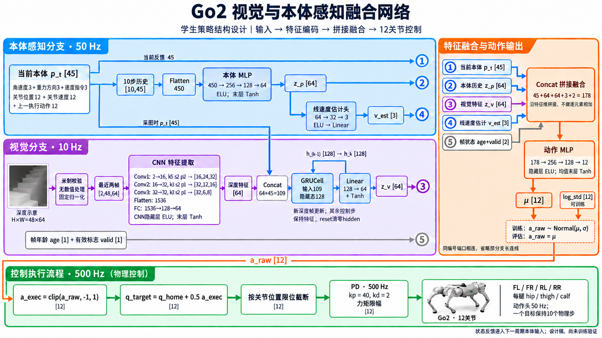

# Go2 视觉与本体融合网络图说明

> 历史结构图：本页PNG为旧178维版本。当前已按用户要求去掉age/valid两维网络输入，采用四路176维融合；以[176维实施方案](视觉与本体感知融合_176维实施方案.md)为准。本轮没有重绘PNG，不能将下图当作当前结构。



本图是待审批的学生策略结构设计，不是训练完成的网络截图。使用内置 image_gen 工具生成，图像未经代码绘制替代；[最终生成与修正提示词](figures/go2_visual_proprio_network_prompt.md)同时保存，便于调整。完整训练方法仍以[技术方案](视觉与本体感知融合_技术设计与实施方案.md)为准。

## 1. 如何读图

蓝色负责机器人自身状态，紫色负责观察和记忆前方地形，橙色负责将特征变成动作，绿色负责把动作执行到关节。

图中的同编号端口表示相连；省略长线是为了避免交叉，不表示省略了对应输入。方括号是张量形状或特征维度，图中省略批量维 B。例如两帧深度的实际形状是 `[B,2,48,64]`。

## 2. 本体分支为什么保留两条路径

当前本体 p_t 有45维：角速度3、重力方向3、速度指令3、关节位置偏移12、关节速度12、上一执行动作12。

第一条路径直接把 p_t 送入最终融合层，让动作头使用当前反馈。第二条路径把最近10步组成 `[B,10,45]`，展平为450维，再经过 `450→256→128→64` 的MLP，得到历史特征 z_p。它用于表征短时状态变化，覆盖约0.2秒。

速度估计头从 z_p 再经过 `64→32→3` 输出机体系线速度估计。它不是读取模拟器真实线速度；真值只在训练时监督估计。进入动作融合前仍按技术方案做固定缩放。

因此，“当前45维”和“历史64维”是两条有不同用途的输入，不是把10帧观测原样重复拼到动作头里。

## 3. 视觉分支在哪里融合本体信息

两张最近深度图堆成两个通道，输入CNN：

| 层 | 参数 | 输出 |
|---|---|---|
| 输入 | H=48，W=64，两帧 | `[B,2,48,64]` |
| Conv1 | 2→16，k=5，s=2，p=2 | `[B,16,24,32]` |
| Conv2 | 16→32，k=3，s=2，p=1 | `[B,32,12,16]` |
| Conv3 | 32→32，k=3，s=2，p=1 | `[B,32,6,8]` |
| Flatten + FC | 1536→128→64 | `[B,64]` |

这里的 k/s/p 分别是卷积核大小、步长和padding。CNN提取空间形状，尚未处理较长的时间记忆。

第一次跨模态融合发生在CNN之后：将深度特征64维与**采集该帧时**的本体45维拼接，得到109维，进入 `GRUCell(109,128)`。GRU可以结合机体运动解释画面变化，并记住之前看到、即将到达足下的地形。128维隐藏状态再通过 `Linear(128,64)+Tanh` 得到视觉特征 z_v。

新深度帧才更新GRU。reset时清零对应机器人的hidden，不能把所有机器人的状态混在同一个hidden中。

## 4. 最终178维到底怎样融合

第二次融合是五块特征沿最后一维拼接：

| 端口 | 输入 | 维度 | 在最终向量中的索引 |
|---|---|---:|---|
| ① | 当前本体 p_t | 45 | 0:45 |
| ② | 本体历史 z_p | 64 | 45:109 |
| ③ | 视觉特征 z_v | 64 | 109:173 |
| ④ | 线速度估计 v_est | 3 | 173:176 |
| ⑤ | 帧年龄 age、有效标志 valid | 2 | 176:178 |

```text
fused = concat(p_t, z_p, z_v, scaled_v_est, vision_meta)
shape = [B,178]
```

这一步不是逐元素相加，也没有手工指定“视觉占60%、本体占40%”。后续动作MLP的权重从训练中学习如何组合这些输入。age/valid使动作头能够区分刚更新的视觉信息与已经保持了一段时间的信息，不自动等于已验证的故障降级能力。

## 5. 从178维到12个关节

动作MLP为 `178→256→128→12`，隐藏层ELU、均值末层Tanh。12维 μ分别对应：

```text
FL_hip, FL_thigh, FL_calf,
FR_hip, FR_thigh, FR_calf,
RL_hip, RL_thigh, RL_calf,
RR_hip, RR_thigh, RR_calf
```

训练时，μ与12个可训练log_std定义Gaussian分布；采样得到a_raw。评估时直接令a_raw=μ。随后必须按图中橙色长线进入左下角的动作限幅框，不能从网络绕过限幅直接送机器人。

执行链路为：

```text
a_exec = clip(a_raw,-1,1)
q_target = clip(q_home + 0.5*a_exec, joint_lower, joint_upper)
```

每条腿默认姿态为 `[0,0.9,-1.8]` rad。网络输出的是位置偏移，不是力矩；PD执行器以kp=40、kd=2跟踪关节目标，并施加模型配置的力矩限制。PPO记录原始采样及其概率，不能拿限幅动作替代原始Gaussian样本。

## 6. 三种频率如何配合

- 深度CNN/视觉GRU：10 Hz，每0.1秒更新一次z_v；期间保持视觉特征。
- 本体、历史编码、速度估计、动作头：50 Hz，每0.02秒使用当前反馈生成新关节目标。
- 物理/PD：500 Hz，每个目标维持10个物理子步，直到下一次策略输出。

因此，低频相机不会让整个机器人控制降到10 Hz。每个控制周期仍有当前本体反馈；每个物理子步仍有PD跟踪。

这张图只解释学生推理链路，教师、critic和训练监督没有画进输入，避免误认为部署时还要读取特权地形或真实线速度。
